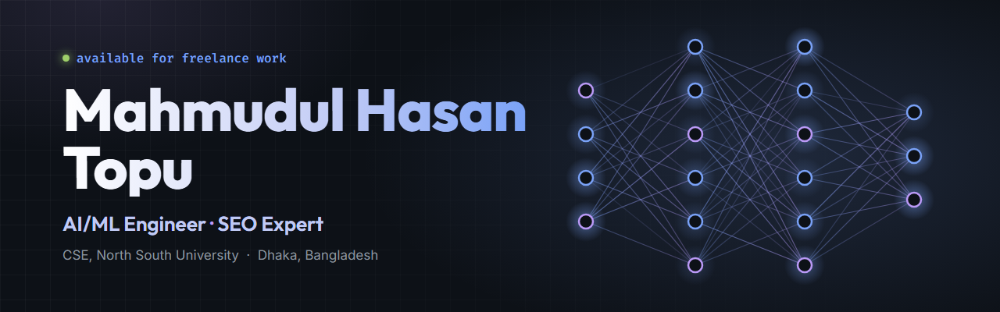

## Hi 👋, I'm Mahmudul Hasan Topu

### 💫 About Me

- 🔭 I build **machine-learning models** and **SEO strategies** as a freelance AI/ML & SEO specialist.
- 🎓 B.Sc. in **Computer Science & Engineering** from **North South University**, majoring in AI & ML.
- 🧠 Most interested in **deep learning, NLP and computer vision**.
- 🧊 Latest project: **[The Cube](https://the-cube-game.vercel.app)**, a 3D puzzle cube you can play in your browser.
- 💬 Ask me about **machine learning, Python, data analysis or technical SEO**.
- 📫 Reach me at **[mahmudulhasan46367@gmail.com](mailto:mahmudulhasan46367@gmail.com)**

### 🌐 Socials

### 💻 Tech Stack

**AI & Machine Learning**

**Backend, Data & Web**

**SEO & Analytics**

**Tools**

### 🚀 Featured Projects

  
  

### 📊 GitHub Stats

  
  

 

  Thanks for stopping by. Let's build something intelligent together. ✨

